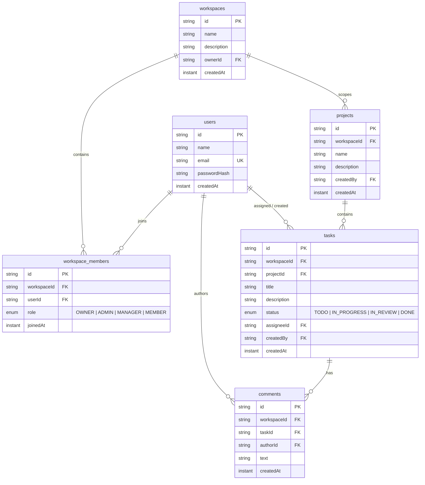
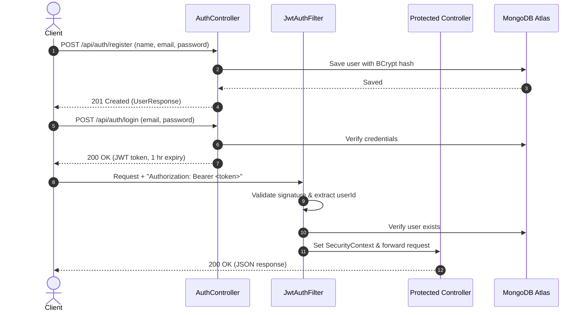

# TeamSync Backend

> A production-grade team collaboration REST API featuring multi-tenant workspace isolation, role-based access control, project tracking, Kanban boards, and discussion threads.

[](https://www.oracle.com/java/)
[](https://spring.io/projects/spring-boot)
[](https://www.mongodb.com/atlas)
[](https://www.docker.com/)
[]()

🔗 **Live API:** [https://teamsync-server-opfl.onrender.com](https://teamsync-server-opfl.onrender.com)  
📖 **Swagger UI:** [https://teamsync-server-opfl.onrender.com/swagger-ui/index.html](https://teamsync-server-opfl.onrender.com/swagger-ui/index.html)  
> **Note:** Hosted on Render's free tier. If the instance has been idle, the initial request takes ~50–60 seconds to spin up from sleep.

<!-- TODO: add Swagger UI or API demo screenshot here -->

---

## ⚡ Features

- **Stateless Authentication:** Registration and login with BCrypt password hashing and signed JWT tokens (1-hour expiry) via a custom `JwtAuthFilter`.
- **User Profile Management:** View and update account profile via `GET` and `PATCH /api/users/me`.
- **Multi-Tenant Workspaces:** Scoped workspaces where roles belong to workspace membership (`WorkspaceMember`), not the user document.
- **Hierarchical Access Control:** Four distinct tiers (`OWNER`, `ADMIN`, `MANAGER`, `MEMBER`) strictly enforced across resources.
- **Project Scoping:** Projects belong strictly to workspaces; only `OWNER`, `ADMIN`, and `MANAGER` can create or modify them.
- **Interactive Kanban Boards:** Manage tasks across 4 columns (`TODO`, `IN_PROGRESS`, `IN_REVIEW`, `DONE`) with assignees restricted to verified workspace members.
- **Task Comments:** Discussion threads with author names dynamically resolved from user records.
- **Defensive Error Handling:** 400 Bad Request on validation errors; 404 Not Found for non-members so workspace existence is never leaked.
- **Application Cascade Deletes:** Deleting a project purges its tasks and comments; deleting a task purges all associated comments.
- **Observability & Docs:** Built-in `/api/health` checking MongoDB ping status; OpenAPI 3.0 (Swagger UI) with JWT Bearer authorization.

---

## 🛠 Tech Stack

- **Runtime & Language:** Java 21 (OpenJDK / Eclipse Temurin)
- **Framework:** Spring Boot 4.1.1 (`spring-boot-starter-webmvc`, `spring-boot-starter-security`, `spring-boot-starter-data-mongodb`, `spring-boot-starter-validation`)
- **Security & Tokens:** Spring Security, JJWT (`jjwt-api`, `jjwt-impl`, `jjwt-jackson` 0.12.6), BCrypt
- **Database:** MongoDB Atlas (Document Store)
- **API Documentation:** SpringDoc OpenAPI 3.0.3 (`springdoc-openapi-starter-webmvc-ui`)
- **Testing:** JUnit 5, Mockito (13 unit tests)
- **Build & DevOps:** Maven 3.9 (Maven Wrapper included), Docker (multi-stage build), Render Cloud

---

## 🏗 Architecture

```
[ Client / Swagger UI ] ──(Bearer JWT)──▶ [ JwtAuthFilter ] ──▶ [ SecurityContext ]
                                                  │
                                                  ▼
                                         [ Controllers ] (DTO Validation)
                                                  │
                                                  ▼
                                         [ Service Layer ] (RBAC & Cascade Logic)
                                                  │
                                                  ▼
                                        [ Mongo Repositories ]
                                                  │
                                                  ▼
                                       [ MongoDB Atlas Cluster ]
```

### Package Structure
```
com.teamsync
├── TeamsyncBackendApplication.java  # Main application entry point
├── auth                             # Auth & Me controllers, JWT service/filter, auth DTOs
├── comment                          # Comment entity, repository, service, controller, DTOs
├── config                           # SecurityConfig (stateless CORS & filter chain), OpenApiConfig
├── health                           # HealthController (ping check)
├── project                          # Project entity, repository, service, controller, DTOs
├── task                             # Task entity, TaskStatus enum, service, controller, DTOs
├── user                             # User document entity and repository
└── workspace                        # Workspace, WorkspaceMember, roles, service, controller
```

---

## 🗄 Data Model



---

## 🔐 Roles and Permissions

Roles attach strictly to `workspace_members` per workspace. A user can be `OWNER` in one workspace and `MEMBER` in another.

| Action | Allowed Roles | Restrictions & Edge Cases |
| :--- | :--- | :--- |
| **View Workspace, Projects, Tasks, Comments, Members** | `OWNER`, `ADMIN`, `MANAGER`, `MEMBER` | Non-members receive `404 Not Found` (no ID leakage) |
| **Add Member** | `OWNER`, `ADMIN` | Cannot assign `OWNER` role (`400`); duplicates return `409 Conflict` |
| **Change Member's Role** | `OWNER` only | Cannot assign `OWNER` role; cannot change `OWNER`'s own role |
| **Remove Member** | `OWNER`, `ADMIN`, Self | Admin cannot remove another Admin; `OWNER` cannot be removed; members can self-leave |
| **Create / Edit Project** | `OWNER`, `ADMIN`, `MANAGER` | `MEMBER` receives `403 Forbidden` |
| **Delete Project** | `OWNER`, `ADMIN` | `MANAGER` & `MEMBER` receive `403`; cascades to project's tasks & comments |
| **Create Task** | Any Workspace Member | Assignee must be a verified member of the workspace |
| **Move Task Status** | Any Workspace Member | Allows flexible Kanban column transitions (`TODO` ➜ `DONE`) |
| **Edit Task Details** | Creator, Assignee, `OWNER`, `ADMIN`, `MANAGER` | Non-assignee/non-creator members receive `403 Forbidden` |
| **Delete Task** | Creator, `OWNER`, `ADMIN`, `MANAGER` | Regular members cannot delete others' tasks; cascades to comments |
| **Post Comment** | Any Workspace Member | Appends author name dynamically |
| **Edit Comment** | Comment Author only | Authors only; even `OWNER`/`ADMIN` cannot edit others' text |
| **Delete Comment** | Author, `OWNER`, `ADMIN`, `MANAGER` | Regular members cannot delete others' comments |

---

## 📡 API Overview

Base URL: `/api`

| Group | Method | Endpoint | Access | Description |
| :--- | :--- | :--- | :--- | :--- |
| **Auth** | `POST` | `/api/auth/register` | Public | Register user (`name`, `email`, `password`) |
| | `POST` | `/api/auth/login` | Public | Authenticate and obtain 1-hour JWT token |
| **Users** | `GET` | `/api/users/me` | Authenticated | Get current user's profile |
| | `PATCH` | `/api/users/me` | Authenticated | Update user display name |
| **Workspaces**| `POST` | `/api/workspaces` | Authenticated | Create workspace (creator becomes `OWNER`) |
| | `GET` | `/api/workspaces` | Authenticated | List all workspaces caller belongs to |
| | `GET` | `/api/workspaces/{id}` | Workspace Member | Get workspace summary and caller's role |
| **Members** | `POST` | `/api/workspaces/{id}/members` | `OWNER`, `ADMIN` | Add member by email with initial role |
| | `GET` | `/api/workspaces/{id}/members` | Workspace Member | List all members with user details and roles |
| | `PATCH` | `/api/workspaces/{id}/members/{userId}` | `OWNER` only | Update member role (`ADMIN`, `MANAGER`, `MEMBER`) |
| | `DELETE`| `/api/workspaces/{id}/members/{userId}` | `OWNER`, `ADMIN`, Self | Remove member or leave workspace |
| **Projects** | `POST` | `/api/workspaces/{wId}/projects` | `OWNER`, `ADMIN`, `MANAGER` | Create project under workspace |
| | `GET` | `/api/workspaces/{wId}/projects` | Workspace Member | List projects in workspace |
| | `GET` | `/api/workspaces/{wId}/projects/{pId}` | Workspace Member | Get project details |
| | `PATCH` | `/api/workspaces/{wId}/projects/{pId}` | `OWNER`, `ADMIN`, `MANAGER` | Update project name or description |
| | `DELETE`| `/api/workspaces/{wId}/projects/{pId}` | `OWNER`, `ADMIN` | Delete project and cascade tasks/comments |
| **Tasks** | `POST` | `/api/workspaces/{wId}/projects/{pId}/tasks` | Workspace Member | Create task (`TODO` by default) |
| | `GET` | `/api/workspaces/{wId}/projects/{pId}/tasks` | Workspace Member | List tasks (supports `?status=` filter) |
| | `GET` | `/api/workspaces/{wId}/projects/{pId}/tasks/{tId}` | Workspace Member | Get task details |
| | `PATCH` | `/api/workspaces/{wId}/projects/{pId}/tasks/{tId}` | Creator / Assignee / Mgt | Update task title, description, assignee |
| | `PATCH` | `/api/workspaces/{wId}/projects/{pId}/tasks/{tId}/status` | Workspace Member | Move task between Kanban columns |
| | `DELETE`| `/api/workspaces/{wId}/projects/{pId}/tasks/{tId}` | Creator / Mgt | Delete task and cascade comments |
| **Comments** | `POST` | `.../tasks/{tId}/comments` | Workspace Member | Post comment on task |
| | `GET` | `.../tasks/{tId}/comments` | Workspace Member | List chronological task comments |
| | `PATCH` | `.../tasks/{tId}/comments/{cId}` | Author only | Edit comment text |
| | `DELETE`| `.../tasks/{tId}/comments/{cId}` | Author / Mgt | Delete comment |
| **Health** | `GET` | `/api/health` | Public | Ping database connectivity and service health |

---

## 🔄 Authentication Flow



---

## 🚀 Getting Started

### Prerequisites
- **Java 21** or later installed
- **Git**
- **MongoDB Atlas** cluster connection URI (or local MongoDB)

### 1. Clone & Setup
```bash
git clone https://github.com/riddhimoyxcode/TeamSync-server.git
cd TeamSync-server
```

### 2. Configure Environment Variables

**PowerShell (Windows):**
```powershell
$env:MONGODB_URI="mongodb+srv://<username>:<password>@cluster.mongodb.net/teamsync?retryWrites=true&w=majority"
$env:JWT_SECRET="<your-long-secure-random-secret-key-at-least-256-bits>"
$env:CORS_ALLOWED_ORIGINS="http://localhost:3000"
$env:PORT="8080"
```

**Bash (Linux / macOS):**
```bash
export MONGODB_URI="mongodb+srv://<username>:<password>@cluster.mongodb.net/teamsync?retryWrites=true&w=majority"
export JWT_SECRET="<your-long-secure-random-secret-key-at-least-256-bits>"
export CORS_ALLOWED_ORIGINS="http://localhost:3000"
export PORT=8080
```

### 3. Run Application
```bash
./mvnw spring-boot:run        # Linux / macOS
.\mvnw.cmd spring-boot:run    # Windows
```
The server starts on port `8080` (or your `$PORT`).

### 4. Swagger UI & Test Suite
- **Interactive Swagger UI:** `http://localhost:8080/swagger-ui/index.html`
- **Execute Unit Tests:**
  ```bash
  ./mvnw test        # Linux / macOS
  .\mvnw.cmd test    # Windows
  ```

---

## 🐳 Docker

Multi-stage build (`maven:3.9-eclipse-temurin-21` builder + lightweight `eclipse-temurin:21-jre` runtime):

```bash
# Build Docker image
docker build -t teamsync-backend .

# Run container (secrets passed at runtime)
docker run -p 8080:8080 \
  -e MONGODB_URI="mongodb+srv://<username>:<password>@cluster.mongodb.net/teamsync?retryWrites=true&w=majority" \
  -e JWT_SECRET="<your-long-secure-random-secret-key-at-least-256-bits>" \
  -e CORS_ALLOWED_ORIGINS="http://localhost:3000" \
  teamsync-backend
```
> **Security Notice:** No credentials, secrets, or connection strings are stored in the container image.

---

## ☁️ Deployment

TeamSync is continuously deployed on **Render** directly from the repository's `Dockerfile`.

### Render Environment Configuration
- **Runtime:** Docker
- **Environment Variables:** `MONGODB_URI`, `JWT_SECRET`, `CORS_ALLOWED_ORIGINS`, `PORT`
- **Cold Start Note:** Render's free tier spins down idle instances after 15 minutes. The initial request after a pause can take up to about a minute to wake up.

---

## 🧪 Testing

The test suite contains **13 unit tests** written with JUnit 5 and Mockito, running in isolated memory:

- **`WorkspaceServiceTest` (4 tests):** Enforces that plain members cannot add members (`403`), nobody can be assigned `OWNER` (`400`), duplicate membership is blocked (`409`), and owners can add members (`201`).
- **`ProjectServiceTest` (3 tests):** Validates cascade deletion of project tasks and comments, prevents member deletion (`403`), and prevents manager deletion (`403`).
- **`TaskServiceTest` (5 tests):** Asserts non-members receive `404`, task assignee must belong to the workspace (`400`), non-assignee/creator members cannot edit (`403`) or delete (`403`), and managers can delete any task with cascading comments.
- **`TeamsyncBackendApplicationTests` (1 test):** Confirms Spring application context boots cleanly.

---

## 💡 Key Design Decisions

1. **Roles on Membership, Not on User:** In multi-tenant environments, assigning roles directly to user documents breaks workspace boundaries. Scoping roles to `WorkspaceMember` allows a user to be an `OWNER` in one workspace and a plain `MEMBER` in another without privilege collision.
2. **Service-Layer RBAC Checks:** Authorization logic lives directly in the Java service layer instead of relying on URL-level `@PreAuthorize` rules. This enables context-aware rules (e.g. allowing task assignees or authors to edit their own items).
3. **Immutability via Java Records:** DTOs are declared as Java 21 `record` types, ensuring clear contracts, compact syntax, and thread-safe data transfer.
4. **Information Hiding (404 for Non-Members):** Non-members attempting to access workspaces, projects, or tasks receive `404 Not Found` rather than `403 Forbidden`. This prevents unauthorized users from probing whether an ID exists.
5. **Orchestrated Cascade Deletes:** Because MongoDB lacks relational foreign key constraints, parent deletions (Project ➜ Tasks ➜ Comments) are handled explicitly in the service layer to avoid orphaned records.
6. **Stateless JWTs & Secret Externalization:** Sessions remain stateless for cloud scalability. All sensitive keys and database credentials are strictly injected via runtime environment variables.

---

## 🗺 Roadmap

- [ ] Refresh token rotation with silent renewal
- [ ] Cursor-based pagination and sorting for tasks and comments
- [ ] Integration test suite using Testcontainers and MongoDB
- [ ] Event-driven email and in-app notifications
- [ ] Real-time Kanban board updates via WebSockets (STOMP)
- [ ] GitHub integration (link commits and PRs to tasks)
- [ ] Gemini AI summaries for project milestone briefs and task threads
- [ ] Full-text search across projects, task descriptions, and comments
- [ ] File and asset attachments for tasks and comments

---

## 👤 Author

**Riddhimoy**  
*Final-Year Electronics & Communication Engineering (ECE) Student*  
- GitHub: [<!-- TODO: confirm your GitHub profile link (e.g. https://github.com/riddhimoyxcode) -->](https://github.com/riddhimoyxcode)
- LinkedIn: [<!-- TODO: add your LinkedIn profile link -->](https://linkedin.com)
<!-- TODO: add personal portfolio or contact email if desired -->
